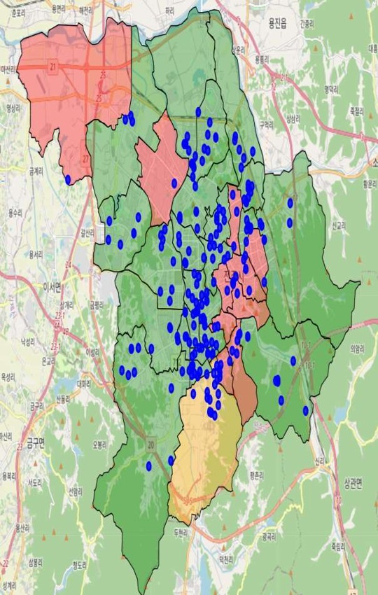

# 전주시 고령 1인세대 돌봄 · 후속 조사 범위를 분석 대상 행정동의 29.4%로 좁힘

**문제 정의** 복지시설 한 곳이 있는 동끼리도 고령 1인세대 규모는 다르다. 시설 개수만 세면 어느 동의 수요와 공급을 먼저 현장에서 살펴봐야 하는지 판단하기 어려웠다.

**해결 방법** 인구 자료와 시설 위치를 행정동별로 결합했다. 고령 1인세대 수·비율, 복지시설 수, 시설부족지수(고령 1인세대 수 ÷ (시설 수 + 1))를 표준화해 K-means로 세 군집을 만들었다. 군집별 평균을 비교해 추가 조사가 필요한 유형을 구분했다.

**확인 결과** 분석 대상 34개 동 중 우선 검토군은 29.4%(10개 동)였다. 조촌동은 고령 1인세대 1,214세대에 복지시설 1곳으로 이 군에 포함됐다. 이 비율은 후속 조사 후보의 비중이다. 실제 미충족 돌봄 수요를 판단하려면 시설 정원·운영 상태·교통 접근성 조사가 더 필요하다.

