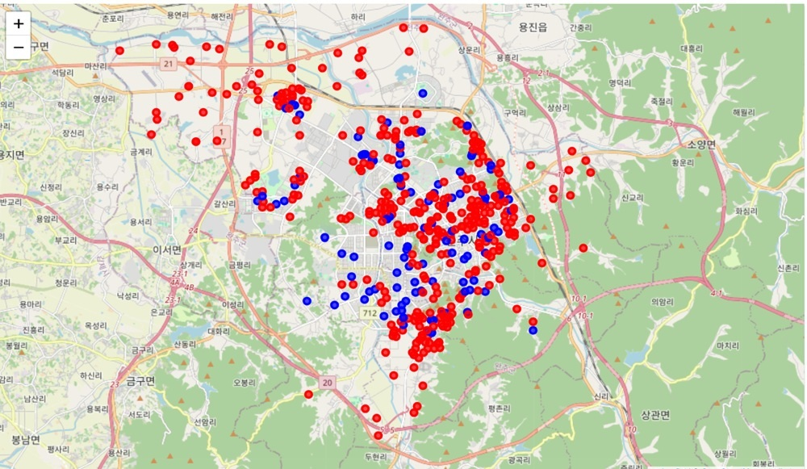

# 전주시 무더위쉼터 · 송천2·3동 등록 쉼터 중 누구나 이용할 수 있는 시설은 6.25%

**문제 정의** 등록 목록에는 특정 이용자만 들어갈 수 있는 시설도 포함돼 있었다. 쉼터가 많아 보이는 동이라도 일반 주민에게 열린 곳이 적을 수 있고, 개방 시설 수가 같아도 주민 수에 따라 이용 여건은 달라진다.

**해결 방법** 이용 대상별로 쉼터를 나누고 GeoPandas로 시설 좌표를 행정동 경계와 결합했다. 등록 시설 중 개방 시설의 비율을 구한 뒤, 답사 후보는 별도 지표인 인구 1,000명당 개방 쉼터 수가 적은 순서로 추렸다.

**확인 결과** 전주시 등록 쉼터 중 개방 시설은 23.0%(110/478곳)였다. 송천2·3동에서는 6.25%(1/16곳)였고, 주민 57,173명 기준 인구 1,000명당 0.017곳이었다. 이 지표로 송천2·3동·인후3동·효자3동을 답사 후보로 좁혔다. 방문 시설에서 기록한 내부 안내 부족은 해당 방문지의 관찰이다.

