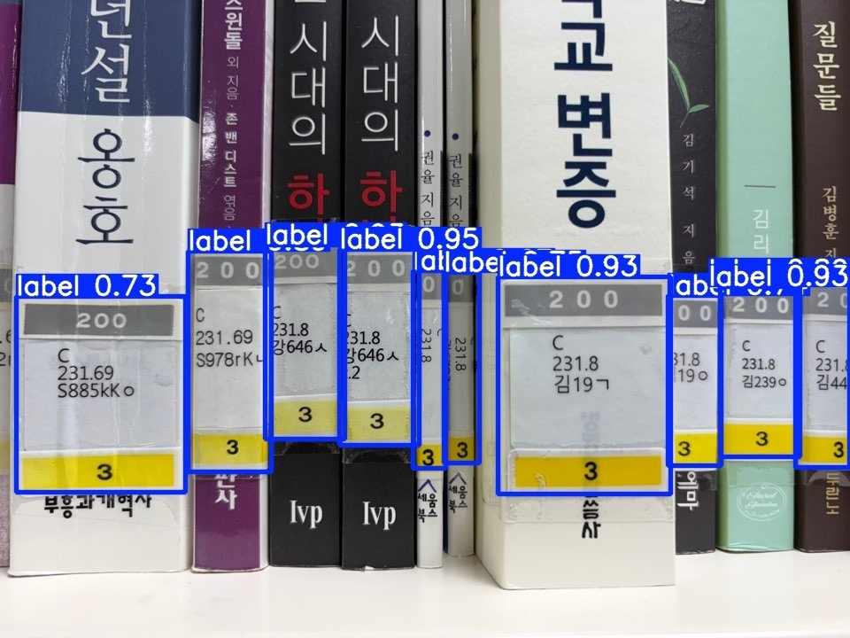

# 책등 청구기호 판독 · 같은 라벨에서 한국어 PP-OCRv5의 줄 일치율이 EasyOCR보다 36.2%p 높음

**문제 정의** 청구기호 한 글자를 잘못 읽어도 다른 책을 가리킬 수 있다. 책을 제대로 읽지 못한 이유가 라벨 위치를 놓쳐서인지, 찾은 라벨의 문자를 틀려서인지 전체 결과만으로는 구분하기 어려웠다.

**해결 방법** 사진 60장으로 YOLO11n을 30회 학습하고 별도 테스트 사진 7장에서 예측 상자와 정답 상자를 일대일로 대응시켰다. OCR 비교에서는 판독 가능한 동일한 207줄을 고정하고 공백·영문 대소문자를 제외한 줄 전체가 맞는지 확인했다. 먼저 전체 라벨에서 엔진을 바꾸고, 다음에는 엔진을 고정해 입력 영역만 바꿨다.

**확인 결과** 검출 재현율은 91.6%(정답 83개 중 76개), 정밀도는 97.4%(예측 78개 중 76개)였다. 전체 라벨의 줄 일치율은 EasyOCR 27.1%(56/207), 한국어 PP-OCRv5 63.3%(131/207)로 36.2%p 차이였다. PP-OCRv5를 고정하면 중앙 입력은 58.5%(121/207)로, 전체 라벨 입력이 4.8%p 높았다. 이 차이는 해당 평가 세트 기준이다.

