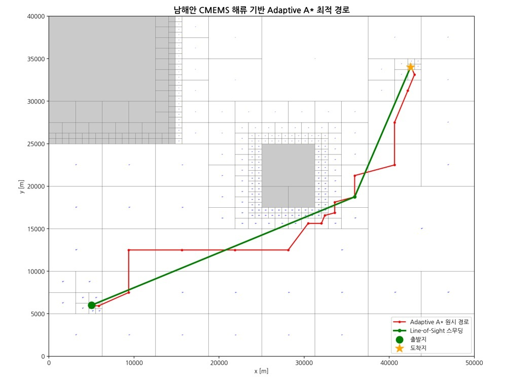

# 해류 경로 계획 · 팀 공동 수행 · 같은 예상 이동시간을 유지하며 확장 노드 18.0% 감소

**문제 정의** 같은 거리라도 순류와 역류에서 이동시간은 달라진다. 해류를 반영한 항로를 찾으면서 탐색 범위까지 줄일 수 있는지 확인하려면, 같은 구간에서 경로의 예상 이동시간과 탐색량을 따로 비교해야 했다.

**해결 방법** ND3 팀이 공동으로 해류의 진행 방향 성분을 격자 간 이동시간 비용에 반영했다. 해안선과 해류 변화에 따라 격자 크기를 조정하고, 같은 제출 샘플에서 Dijkstra와 A*를 비교했다. 탐색이 끝난 뒤 직선으로 연결 가능한 구간의 중간 경로점을 줄였다.

**확인 결과** 두 알고리즘의 예상 이동시간은 같았다. Dijkstra를 기준으로 A*의 확장 노드가 18.0% 감소했다(228개 → 187개). 별도의 단순화 단계에서는 경로점이 85.7% 줄었다(21개 → 3개). 실행시간과 실제 선박 운항시간은 측정하지 않았다.

